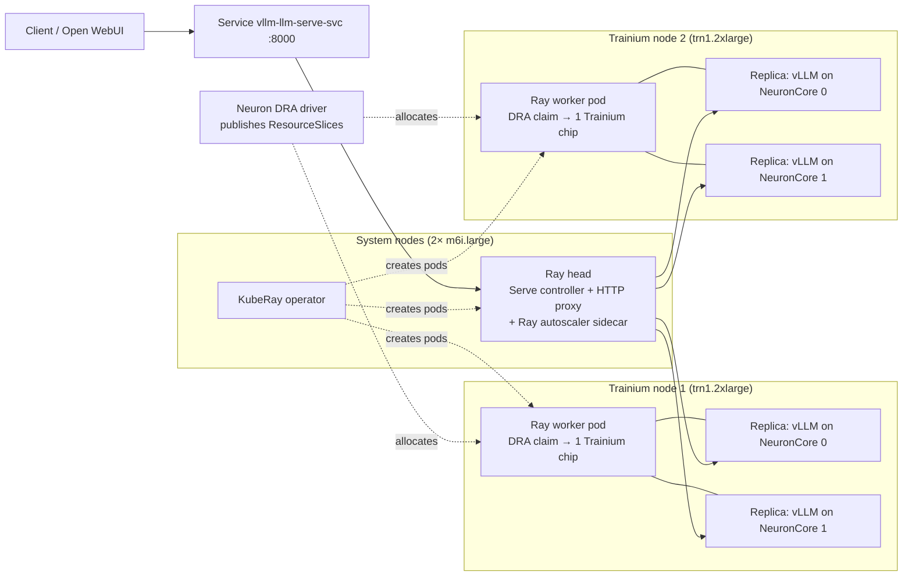

# LLM Inference on Amazon EKS with DRA, vLLM and KubeRay

A reference architecture for serving open-weights large language models on Amazon EKS with
AWS Trainium. Accelerators are allocated declaratively with Kubernetes **Dynamic Resource
Allocation (DRA)**, models are served by **vLLM**, and **KubeRay / Ray Serve** scale inference
across nodes under load. No device plugins, no scheduler extensions.

Validated end to end on EKS 1.34 with 2× `trn1.2xlarge`, serving `Qwen/Qwen2.5-1.5B-Instruct`
through an OpenAI-compatible API.

## Architecture



### Components

| Component | Role |
|---|---|
| **Neuron DRA driver** | DaemonSet on each Trainium node. Publishes each device as a `ResourceSlice` with attributes (instance type, device ID, driver version, network topology) under DeviceClass `neuron.aws.com`. The Neuron device plugin is disabled. |
| **ResourceClaimTemplate** | Requests a device with a CEL selector, e.g. `device.attributes["neuron.aws.com"].instanceType == "trn1.2xlarge"`. Kubernetes creates one claim per Ray worker pod. |
| **KubeRay operator** | Reconciles the `RayService` into Ray head and worker pods and Services, handles health checks and zero-downtime upgrades. |
| **Ray cluster autoscaler** | Sidecar in the Ray head. Adds a worker pod (with its own DRA claim) when replicas can't find a free NeuronCore; removes idle workers. |
| **Ray Serve** | Routes requests and scales replicas on in-flight requests. Each replica owns exactly one NeuronCore. |
| **vLLM (Neuron backend)** | The inference engine inside each replica: continuous batching, KV cache, OpenAI-compatible API. |
| **Open WebUI** | Optional browser chat front end calling the in-cluster endpoint. |

### Request path

`client → vllm-llm-serve-svc → Ray Serve proxy (on the head and every worker) → replica actor →
vllm serve (loopback) → NeuronCore`, with responses (including streaming) returned the same way.

### Scaling model

| Layer | Unit | Scales | Mechanism |
|---|---|---|---|
| Replicas | Ray actor + one vLLM process, pinned to one NeuronCore | 1 → 4 | Ray Serve autoscaling on in-flight requests |
| Worker pods | Ray worker holding one Trainium chip via DRA | 1 → 2 | Ray cluster autoscaler → KubeRay |
| Nodes | trn1.2xlarge | fixed pool | Pre-provisioned static capacity |

Replicas first fill free NeuronCores on existing chips (two replicas per chip). When every core
is in use, the Ray autoscaler adds a worker pod, which claims a chip on the next node.

## Design decisions

**DRA instead of the device plugin.** Hardware is selected by attributes instead of an integer
count, without the Neuron scheduler extension. The same mechanism extends to topology-aware
allocation, connected device subsets, per-workload Logical NeuronCore configuration and, with the
EFA DRA driver, aligned Neuron + EFA allocation for models that span machines.

**One replica per NeuronCore.** A trn1.2xlarge chip has two NeuronCores. Running a replica on each
(tensor parallelism 1) bin-packs two model copies onto one chip instead of dedicating the chip to
one copy, and lets replicas scale in finer steps than whole pods.

**Static accelerator capacity.** Node autoscalers can't yet predict the devices a Neuron DRA node
will publish before it exists (Karpenter dynamic provisioning and Cluster Autoscaler scale-from-zero
both lack Neuron DRA support on AWS). The Trainium pool is therefore sized up front, and pods and
replicas scale within it. If on-demand node provisioning from zero matters more than declarative
allocation, use the Neuron device plugin with Karpenter instead.

**Pre-warmed nodes.** Model weights, the Neuron compile cache and compiled model artifacts live on a
host directory per node. After the first start on a node, a new replica is serving in under a
minute instead of recompiling.

## Measured results

Stepped load against the in-cluster endpoint (`scripts/stepped-load.sh "4:45 24:120 24:120"`),
starting from one replica:

| Step | Concurrency | Phase | req/s | tokens/s | p50 (s) | p95 (s) | Errors |
|---|---|---|---|---|---|---|---|
| 1 | 4 | 1 replica | 0.39 | 49.5 | 10.3 | 10.4 | 0 |
| 2 | 24 | scaling 1 → 4 replicas, 1 → 2 nodes | 1.37 | 175.2 | 10.9 | 48.6 | 0 |
| 3 | 24 | 4 replicas on 2 nodes | 2.21 | 283.0 | 10.7 | 11.0 | 0 |

Scale-out from load spike to four serving replicas across two nodes took about 2 min 50 s on
pre-warmed nodes. Scale-down: replicas after ~2 min idle, the extra worker pod ~3 min later.

## Repository layout

| Path | Contents |
|---|---|
| `terraform/` | VPC, EKS 1.34, system and Trainium node groups, Neuron DRA driver, KubeRay operator |
| `manifests/01-dra-resourceclaim.yaml` | Standalone DRA validation: CEL claim for a Trainium device, verified with `neuron-ls` |
| `manifests/02-vllm-rayservice.yaml` | Inference service: RayService, DRA claim template, Ray autoscaler |
| `manifests/serve_app.py` | Ray Serve application (deployed as ConfigMap `vllm-serve-app`) |
| `manifests/03-chat-ui.yaml` | Open WebUI front end |
| `scripts/smoke-test.sh` | One chat completion through a port-forward |
| `scripts/quality-check.sh` | Fixed prompts at temperature 0; flags incoherent output |
| `scripts/stepped-load.sh` | Stepped load from inside the cluster; req/s, tokens/s, p50/p95 per step |
| `scripts/load-test.sh` | Burst load from inside the cluster |
| `scripts/watch-scaling.sh` | Live view of replicas, NeuronCores, per-node placement and worker pods |

## Deployment

Prerequisites: Terraform ≥ 1.6, AWS CLI v2, `kubectl`, `helm`, and Trainium vCPU quota in the
target region (default `us-east-2`).

```bash
# 1. Infrastructure (~25 min)
cd terraform
terraform init
terraform apply
aws eks update-kubeconfig --region us-east-2 --name eks-llm-inference
cd ..

# 2. Inference service and chat UI
kubectl create configmap vllm-serve-app --from-file=serve_app.py=manifests/serve_app.py \
  --dry-run=client -o yaml | kubectl apply -f -
kubectl apply -f manifests/02-vllm-rayservice.yaml
kubectl apply -f manifests/03-chat-ui.yaml
kubectl get rayservice vllm-llm -w            # wait for "Running" (first start ~15 min)

# 3. Verify
./scripts/quality-check.sh 2                  # expect 8/8 coherent answers
kubectl port-forward svc/open-webui 3000:80   # chat at http://localhost:3000

# 4. Exercise scaling (two terminals)
./scripts/watch-scaling.sh
./scripts/stepped-load.sh "4:45 24:120 24:120"
```

To pre-warm both Trainium nodes, run one sustained load (`./scripts/stepped-load.sh "24:900"`)
after the first deployment so each node compiles the model once.

If a Helm pull from `public.ecr.aws` fails with an expired token, run
`helm registry logout public.ecr.aws` and retry.

## Operations

- **Endpoints:** `vllm-llm-serve-svc:8000` (OpenAI-compatible API) and `vllm-llm-head-svc:8265`
  (Ray dashboard). KubeRay keeps these names stable across RayService upgrades.
- **Resizing the Trainium pool:** the EKS module ignores `desired_size` after creation. Resize a
  live group with `aws eks update-nodegroup-config`, and keep `neuron_desired_size` in sync.
- **Configuration changes:** changes to `serveConfigV2` restart replicas; changes to
  `rayClusterConfig` make KubeRay build a new Ray cluster beside the old one, which needs a free
  Trainium chip for its worker.
- **Load testing:** run load from inside the cluster (the scripts do this). A `kubectl
  port-forward` drops connections under parallel load.

## Image-specific configuration

Each item below addresses a real failure with vLLM 0.16.0 + vLLM-Neuron 0.5.3 + Ray 2.57 in
`pytorch-inference-vllm-neuronx:0.16.0-neuronx-py312-sdk2.31.1-ubuntu24.04`.

| Symptom | Cause | Resolution (where) |
|---|---|---|
| Neuron DRA DaemonSet `DESIRED 0` on inf2 | Chart affinity excludes `inf*` | Use Trainium (`terraform/variables.tf`) |
| Ray head evicted, `no space left on device` | ~18 GB image vs 20 GB root disk | 100 GB system disks (`terraform/main.tf`) |
| Ray pods restart-loop, probe on `:52365` refused | Image ships Ray core, not `ray[default]` | Init container installs the extras into `/pydeps` (`02-vllm-rayservice.yaml`) |
| `ray.serve.llm` import error | Ray 2.57 expects a newer vLLM module layout | Serve app proxying `vllm serve` (`serve_app.py`) |
| vLLM exits: `block_size must be set` | Prefix caching on by default in vLLM 0.16 | `--block-size 32` |
| Fluent first token, then garbage | `--no-enable-prefix-caching` selects a broken KV layout | Keep prefix caching on with `--block-size 32` |
| 500s under load, `sample_tokens() called without prior execute_model()` | Async scheduling vs the Neuron runner | `--no-async-scheduling` |
| Crash under load, `status=1006 Execution Out-Of-Bounds Memory Access` | Scheduler KV pool larger than the compiled graph | `--num-gpu-blocks-override 512` |
| Every replica rebuilds the model | vLLM-Neuron deletes its default artifact directory before loading | Stable `NEURON_COMPILED_ARTIFACTS` + per-node compile lock (`serve_app.py`) |
| Ray autoscaler never adds a worker | It can't read DRA claims | `resources: {neuron_cores: "2"}` on the worker group |
| Chat UI: `"auto" tool choice requires --enable-auto-tool-choice` | Open WebUI sends built-in tools as function calls | `DEFAULT_MODEL_METADATA` / `DEFAULT_MODEL_PARAMS` (`03-chat-ui.yaml`) |

## Limitations

- **Regional capacity:** in `us-east-2`, `trn1.2xlarge` is only offered in `us-east-2c`; Terraform
  selects a matching AZ automatically. Kubernetes 1.34+ is required for DRA.
- **Node elasticity:** the Trainium pool is static (see Design decisions).
- **Cold start:** the first start on a node pulls an ~18 GB image (~4 min) and compiles the model
  (~10 min). Pre-warm before production traffic.
- **Model size:** the reference model is small (1.5B parameters) so two copies fit per chip. It is
  fluent but unreliable on niche facts and arithmetic. Larger models need tensor parallelism across
  NeuronCores (fewer replicas per chip) or larger Trainium instances.

## Security

- The EKS API endpoint is public (`cluster_endpoint_public_access = true`) with no CIDR limit. IAM
  still gates access; restrict it with `cluster_endpoint_public_access_cidrs` for long-lived use.
- Open WebUI runs with login disabled (`WEBUI_AUTH=false`). That's only acceptable because its
  Service is `ClusterIP` and reached through a local port-forward. Enable auth before exposing it
  through a LoadBalancer or Ingress.
- The inference endpoint has no authentication and is only reachable inside the cluster. Add an
  authenticating gateway before exposing it.

## Cost and teardown

About $3/hr while running (2× trn1.2xlarge ≈ $2.69, EKS control plane $0.10, 2× m6i.large and a
NAT gateway).

```bash
kubectl delete -f manifests/03-chat-ui.yaml
kubectl delete -f manifests/02-vllm-rayservice.yaml
cd terraform && terraform destroy
```
